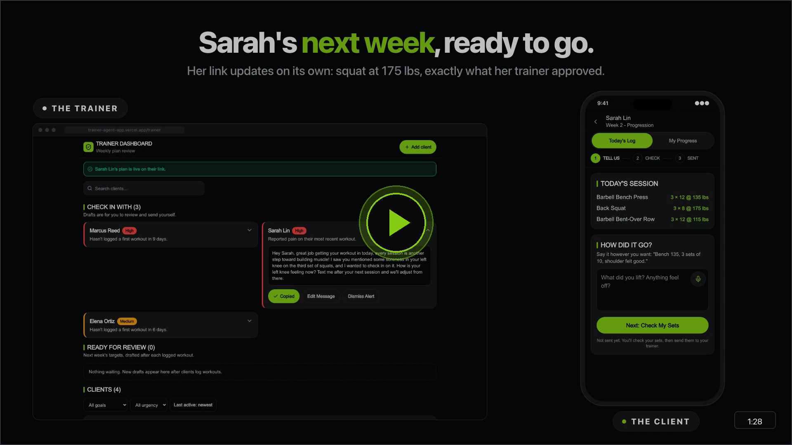

# 🏋️ Trainer Progression App

<div align="center">

> **Next week's workouts drafted from last week's logs. The trainer approves every one.**

[](https://nextjs.org/)
[](https://fastapi.tiangolo.com/)
[](https://anthropic.com/)
[](https://supabase.com/)
[](#stealth-volt-theme)
[](https://trainer-agent-app.vercel.app/)

<p align="center">
  <a href="https://trainer-agent-app.vercel.app/"><strong>🌐 Live Application</strong></a> &bull;
  <a href="https://trainer-agent-app.vercel.app/s/demo-client-session"><strong>📱 Client Mobile Demo</strong></a> &bull;
  <a href="https://trainer-agent-app.vercel.app/trainer"><strong>🛡️ Trainer Dashboard</strong></a> &bull;
  <a href="presentation/promo-video.mp4"><strong>🎬 Promo Video (1:28)</strong></a> &bull;
  <a href="https://trainer-progression-api.onrender.com/health"><strong>⚡ API Health</strong></a> &bull;
  <a href="./presentation/README.md"><strong>📊 Presentation Deck</strong></a>
</p>

</div>

---

## 🎬 Product Walkthrough Video (1:28)

<!-- Lead Front Media: Clickable promo walkthrough video card presenting the end-to-end user experience in standard GitHub markdown -->
<div align="center">
  <a href="presentation/promo-video.mp4" title="Click to watch the Trainer Progression App Promo Walkthrough (1:28)">
    
  </a>

  <p align="center">
    <a href="presentation/promo-video.mp4">
      
    </a>
  </p>

  <p align="center">
    <sub>⚡ <strong>Watch the Promo Walkthrough (1:28)</strong>: Experience frictionless client mobile voice logging, conversational AI set extraction, mathematical double-progression calculation, safety conflict auditing, and 1-click trainer approval.</sub>
    <br>
    <sub>Direct video file: <a href="presentation/promo-video.mp4"><code>presentation/promo-video.mp4</code></a> &bull; Extended Loom demo (3:00): <a href="presentation/demo.mp4"><code>presentation/demo.mp4</code></a> &bull; Interactive slide deck: <a href="presentation/slides.html"><code>presentation/slides.html</code></a> &bull; Master deck PDF: <a href="presentation/deck.pdf"><code>presentation/deck.pdf</code></a></sub>
  </p>
</div>

---

## 💡 Executive Summary & Vision

### The Problem
Independent personal trainers spend **3 to 5 hours every weekend** manually rebuilding client workout spreadsheets row by row. They copy numbers in Google Sheets or Excel, calculate double-progression weight increments in their head, and cross-reference hundreds of fragmented chat messages.

When clients report subtle pinching, fatigue, or joint pain in passing (*"bench was fine, but my shoulder pinched on set 3 so I only got 8"*), it gets buried in text threads. Worse, inactive clients drift away unnoticed until their monthly subscription lapses. Existing gym platforms like Trainerize force repetitive manual workout editing and lock client data behind steep per-client paywalls.

### The Solution
The **Trainer Progression App** automates weekly programming through a decoupled, human-in-the-loop multi-agent architecture:

1. **Frictionless Mobile Logging**: Clients open a private session link on their phone (`/s/:token`) with zero account friction. They speak or text their completed sets, reps, and feedback naturally with sweaty, chalky hands.
2. **AI Reads, Code Decides the Numbers**:
   - **Workout Logger Agent** (`claude-sonnet-5-5`) translates conversational speech or messy chat into structured workout sets and identifies pain notes.
   - **Progression Engine** (pure, deterministic Python code) calculates exact load and rep progressions mathematically. **The LLM never generates numbers.**
   - **Progression Planner Agent** (`claude-haiku-5-5`) audits held lifts against client injury history to surface safety alerts.
3. **1-Click Trainer Superpowers**: The personal trainer reviews staged progression drafts and safety flags on a desktop/tablet dashboard, makes instant adjustments, and taps **Approve**. Next week's workout is pushed immediately to the client's phone.

| Traditional Workflow | Trainer Progression App |
| :--- | :--- |
| 📱 **Open spreadsheets or apps**: Clunky navigation while training | 🎙️ **Frictionless Mobile Logging**: Tap a private link and speak or text in plain words |
| 📋 **Copy-paste rows by hand**: Rebuilding workout rows cell by cell | ⚡ **Automated Staged Drafting**: Next week drafted automatically from completed logs |
| 🧮 **Manual progression math**: Calculating loads and reps in your head | ⚙️ **Deterministic Engine**: Mathematical double-progression sets load strictly |
| ⚠️ **Missed pain text alerts**: Subtle pain signals buried in chat threads | 🚨 **Instant Safety Flagging**: Pain detected, lift held, and flagged for review |
| 👻 **Inactive clients drift**: Disengaged clients drop off unnoticed | 💬 **Trainer Assistant**: Proactive triage summaries and draft check-in outreach |
| ⏳ **3–5 hours every weekend**: Tedious, repetitive programming fatigue | ⏱️ **Under 20 minutes**: Review and approve entire client roster in minutes |

---

<a id="stealth-volt-theme"></a>
## 🎨 Design System & "Stealth Volt" Theme

The application's visual language is modeled on high-performance athletic apparel: **"Stealth Volt"**. It combines deep obsidian backgrounds with razor-sharp 1px borders and high-visibility athletic accents to maximize contrast in bright gym environments and dimly lit weight rooms.

| Token | Swatch | Hex Code | System Role & Semantics |
| :--- | :---: | :---: | :--- |
| **Ground** | `⬛` | `#09090b` | Obsidian black base background; non-distracting canvas |
| **Surface** | `◼️` | `#18181b` | Flat graphite card backgrounds with sharp 1px hairline borders |
| **Hairline** | `◽` | `#27272a` | Clean structural separation borders and divider lines |
| **Ink** | `⬜` | `#fafafa` | Primary typography; high contrast readable text |
| **Volt Action** | `🟢` | `#84cc16` | High-energy primary actions, active mic pulse, submit buttons |
| **Emerald** | `❇️` | `#10b981` | Safe progression, target achieved, healthy status |
| **Amber** | `🟡` | `#f59e0b` | Stalled lift, max effort held, review suggested |
| **Crimson** | `🔴` | `#ef4444` | Pain detected, joint flare-up, hard safety gate |

> [!TIP]
> **Mobile Gym-Floor UX Standards**
> - **Touch Targets**: Every interactive element enforces a minimum touch target of ≥ 44px (`min-h-[44px]` / `touch-target`).
> - **Crash Resilience**: Client voice inputs and set drafts save to `localStorage` on every keystroke, surviving browser reloads mid-workout.
> - **Scroll Isolation**: Tabular workout logs and client lists use dedicated scrollable containers (`.scrollable-container`) separate from page scroll.

---

## 🏛️ System Architecture

The monorepo separates conversational client intake from deterministic backend rules and trainer oversight:

```
+---------------------------------------------------------------------------------------+
|                                 CLIENT MOBILE BROWSER                                 |
|  - Private link access: /s/:sessionToken (Zero account login friction)                |
|  - Conversational speech-to-text / chat logging                                      |
|  - Interactive set review & confirmation card (Client Human-in-the-Loop)              |
|  - In-browser localStorage crash recovery                                             |
+-------------------------------------------+-------------------------------------------+
                                            |
                                            | HTTPS / JSON (REST API v1)
                                            v
+---------------------------------------------------------------------------------------+
|                              TRAINER REVIEW DASHBOARD                                 |
|  - Protected by Supabase Auth (/trainer)                                              |
|  - Staged progression queue: Engine drafts weights; Planner flags safety conflicts     |
|  - Urgency categorization: Routine (bulk approve), Medium, and High (pain/fatigue)    |
|  - 1-Click Plan Approval (Trainer Human-in-the-Loop checkpoint)                       |
+-------------------------------------------+-------------------------------------------+
                                            |
                                            v
+---------------------------------------------------------------------------------------+
|                             FRONTEND (Next.js 15 / Vercel)                            |
|  - TypeScript + Tailwind CSS ("Stealth Volt" theme)                                   |
|  - Safe-area inset padding + 44px touch targets                                       |
|  - Supabase JS Client for trainer authentication                                      |
+-------------------------------------------+-------------------------------------------+
                                            |
                                            | REST API (/api/v1)
                                            v
+---------------------------------------------------------------------------------------+
|                             BACKEND (FastAPI / Render)                                |
|  +---------------------------+   +----------------------------+   +----------------+  |
|  |  Workout Logger (AI)      |   | Progression Engine (Code)  |   | Progression    |  |
|  |  Claude Sonnet 5.5        |   | Pure Python Protocol       |   | Planner (AI)   |  |
|  |  Conversational extraction|-->| Sets weights & reps strictly|-->| Claude Haiku   |  |
|  |  Detects pain & sets      |   | mathematically             |   | Flags injuries |  |
|  +---------------------------+   +----------------------------+   +----------------+  |
|  - PyJWT Supabase Token Verification & Multi-Tenant Trainer Isolation                 |
|  - Async SQLAlchemy 2.0 + Psycopg Binary + Alembic Migrations                         |
+-------------------------------------------+-------------------------------------------+
                                            |
                                            v
+---------------------------------------------------------------------------------------+
|                                DATA & AUTH (Supabase)                                 |
|  - Supabase PostgreSQL (Async connection pool with direct migration URL)              |
|  - Supabase Auth (Trainer sign-in accounts only)                                      |
|  - Unique UUID ClientSession tokens for passwordless client access                   |
+---------------------------------------------------------------------------------------+
```

---

## 🤖 The 3 Specialized Agents

Every AI agent in this application is bounded by a strict harness conforming to our [Agent Engineering Doctrine](./agents.md):

| Agent & Model | System Role | Trigger & Cadence | Permissions & Boundaries | Defensive Guardrails |
| :--- | :--- | :--- | :--- | :--- |
| **Workout Logger**<br>`claude-sonnet-5-5` | **Front-Facing Conversational Intake**<br>Parses unformatted gym speech or chat messages into validated set rows (`exercise_id`, `set_num`, `weight_lbs`, `reps`, `pain_flag`). | On-demand whenever a client submits text or voice note. | **Read**: Today's prescribed workout plan.<br>**Write**: Staged set draft for client confirmation.<br>**Refusal**: Never commits data without client confirmation; never gives medical or programming advice. | Untrusted inputs wrapped in <code>&lt;CLIENT_CHAT_DATA&gt;</code> tags. Re-prompts once on malformed JSON before gracefully falling back. |
| **Progression Planner**<br>`claude-haiku-5-5` | **Backend Safety Auditor**<br>Cross-references held lifts against client injury history and recent pain notes. Appends a `[Planner]` warning flag. | Scheduled or batch-triggered during weekend planning. Runs **only** when a lift was held and client has injury/pain notes. | **Read**: Completed logs, held lifts, and injury history.<br>**Write**: Diagnostic flag message and one audit row in `agent_traces`.<br>**Refusal**: **NEVER modifies weight or rep numbers.** Never communicates with the client. | Read-only check. Engine numbers are immutable. If the planner times out or fails, the engine draft remains intact. |
| **Trainer Assistant**<br>`claude-sonnet-5-5` | **Front-Facing Client Retention**<br>Monitors client workout adherence, detects training drop-offs (>5 days inactive), and drafts personalized check-in messages. | Daily automated background pass or trainer roster search. | **Read**: Client roster, workout timestamps, goal profiles.<br>**Write**: Staged check-in message card for trainer review.<br>**Refusal**: **NEVER sends messages directly.** Requires explicit trainer review and click-to-send. | Output strictly constrained to editable draft templates. No autonomous external communication. |

### 🛡️ Agent Observability & State Management
In alignment with our agent engineering doctrine, all agent pipelines enforce deterministic observability and error boundaries:
- **Explicit State Indicators**: Every agent task exposes discrete operational states: `idle`, `processing` (with active agent name and model), `success`, `failure`, and `timeout`.
- **Model Attribution**: Successful runs explicitly report the underlying model (`claude-sonnet-5-5` or `claude-haiku-5-5`). Fallback routines document the reason and the deterministic fallback rule.
- **Fail-Safe & Unlocked Recovery**: On timeout or API error, the harness categorizes the root cause without deadlocking. Interactive retry controls remain unlocked, and database transactions (`async with session.begin()`) guarantee partial writes roll back cleanly.
- **Trace Auditing**: Background safety audits (`Progression Planner`) log exact input contexts and model responses to the `agent_traces` table for post-session debugging and human review.

---

## ⚙️ Deterministic Progression Engine (`EffortBasedProgression`)

> [!IMPORTANT]
> **Core Architectural Doctrine: AI Reads, Code Decides Numbers**
> LLMs hallucinate numbers and drift on arithmetic. In physical training, an accidental +50 lb hallucination can cause real-world tendon tears or spine injury. Therefore, **all weight and repetition progressions are calculated by deterministic Python code**, never by an LLM.

### Double-Progression Rules (8–12 Rep Target Range)

```
                       +-----------------------------+
                       |   Completed Exercise Log    |
                       +--------------+--------------+
                                      |
                       +--------------v--------------+
                       | Any Pain Reported or Missed |
                       | Sets / Hard Effort / No RPE |
                       +--------------+--------------+
                                     / \
                               YES  /   \  NO (Easy Effort)
                                   /     \
    +-----------------------------v-+   +-v---------------------------+
    |         HOLD LOAD & REPS      |   |       Current Reps < 12?    |
    |  - Same weight as last week   |   +--------------+--------------+
    |  - Same reps as last week     |                 / \
    |  - Staged for trainer review  |           YES  /   \  NO (At 12 Reps)
    +-------------------------------+               /     \
                                   +---------------v-+   +-v--------------------------+
                                   |   INCREASE REPS |   |        Is Bodyweight Lift? |
                                   |  - Reps: +2     |   +-------------+--------------+
                                   |  - Weight: Hold |                / \
                                   +-----------------+          YES  /   \  NO (Barbell/Dumbbell)
                                                                    /     \
                                   +-------------------------------v-+   +-v--------------------------+
                                   |     HOLD AT 12 REPS             |   |      PROGRESS LOAD         |
                                   |  - Bodyweight progression left  |   |  - Weight: +5 lbs          |
                                   |    for trainer decision         |   |  - Reps: Reset to 8 reps   |
                                   +---------------------------------+   +----------------------------+
```

1. **Pain, Missed Reps, or Hard Effort**: If a client reports pain, misses target reps, marks effort as challenging, or logs no effort, the lift is **held** (same weight, same reps).
2. **Easy Effort (Under 12 Reps)**: Reps increase by **+2 reps** (e.g., 10 reps → 12 reps), keeping weight constant.
3. **Easy Effort (At 12 Reps, Weighted)**: Weight increases by **+5 lbs**, and reps reset to base (8 reps).
4. **Easy Effort (At 12 Reps, Bodyweight)**: Held at 12 reps with a prompt for the trainer to prescribe advanced variations (e.g., tempo, deficit, or added load).

---

## 🧪 PRD Evaluation Cards

We evaluate our agent pipelines against concrete gym floor test cases:

| Case | Client Input | Expected Agent & Engine Response | Safety Outcome |
| :--- | :--- | :--- | :--- |
| **Case 1: Golden (Normal)** | *"Did bench 135 for 3 sets of 10. Felt good."* | Sets extracted: 3 sets of 10 @ 135 lbs. `pain_flag: false`. Engine calculates: Easy effort under 12 reps → 135 lbs for 12 reps next week. | 🟢 Automatic routine staging. Ready for 1-click bulk approval. |
| **Case 2: Golden (Edge / Pain)** | *"Squats were easy did em all. Bench my shoulder was pinching on the last set so I only got 8."* | Squats: 3x10 @ target. Bench Set 3: 8 reps, `pain_flag: true`, note: *"shoulder pinching"*. Squats progress (+2 reps); bench **held** (135 lbs x 10 reps). Planner flags shoulder conflict. | 🔴 High-urgency card staged on trainer dashboard. Requires manual trainer sign-off. |
| **Case 3: Adversarial / Off-Topic** | *"I hate Mondays. When is the gym closing?"* | Workout Logger returns status `incomplete`, extracted sets `[]`, and asks: *"Looks like you haven't logged your sets yet. Did you hit the prescribed exercises today?"* | 🛡️ Zero hallucinated sets. Immune to conversational prompt injection. |

---

## 🛠️ Tech Stack & Directory Structure

```
trainer-agent-app/
├── frontend/               # Next.js 15+ App Router, TypeScript, Tailwind CSS
│   ├── src/
│   │   ├── app/            # App Router: / (Home), /s/[sessionToken] (Client), /trainer (Portal)
│   │   ├── components/     # UI primitives: workout cards, mic recorder, triage container
│   │   └── lib/            # Supabase browser client, API utilities
│   ├── tailwind.config.ts  # "Stealth Volt" theme tokens & touch target extensions
│   └── package.json
│
├── backend/                # FastAPI, Python 3.10+, SQLAlchemy 2.0 Async, Alembic
│   ├── app/
│   │   ├── agents/         # Anthropic Claude harness (Workout Logger, Progression Planner)
│   │   ├── core/           # Security, PyJWT token validation, CORS configuration
│   │   ├── models/         # SQLAlchemy ORM models (Client, Plan, Log, Alert, Trace)
│   │   ├── schemas/        # Pydantic v2 schemas and validation contracts
│   │   ├── services/       # Progression engine protocol, weekly planning loops
│   │   └── main.py         # FastAPI application entry point & routing
│   ├── tests/              # 100+ pytest unit, regression, and schema tests
│   ├── alembic/            # Database schema migrations
│   ├── Dockerfile          # Production container setup (Render)
│   └── pyproject.toml
│
├── presentation/           # Stakeholder presentation deck & media assets
│   ├── promo-video.mp4     # 1:28 lead promo walkthrough video
│   ├── slides.html         # Interactive browser slide deck with presenter notes
│   ├── deck.pptx           # 16:9 widescreen PowerPoint deck
│   ├── deck.pdf            # Master 10-slide presentation PDF
│   └── deck-slides/        # High-definition slide exports & video posters
│
├── documents/              # Complete PRD, ADRs, user flows, and data architecture
└── agents.md               # Agent Engineering Doctrine & safety harness manual
```

---

## 🚀 Quickstart Guide

### 1. Clone the Repository
```bash
git clone git@github-pursuit:justin-day-pursuit/trainer-agent-app.git
cd trainer-agent-app
```

### 2. Configure Environment Variables
Copy the environment templates in both `backend` and `frontend`:
```bash
# Backend environment setup
cp backend/.env.example backend/.env

# Frontend environment setup
cp frontend/.env.example frontend/.env
```
Fill in your Supabase project credentials and Anthropic API key in `.env`.

---

### 3. Backend Setup & Run

#### Option A: Using `uv` (Recommended)
```bash
cd backend
uv sync
uv run uvicorn app.main:app --reload --port 8000
```

#### Option B: Using standard Python `venv`
```bash
cd backend
python3 -m venv .venv
source .venv/bin/activate
pip install -e ".[dev]"
uvicorn app.main:app --reload --port 8000
```

Backend will be live at `http://localhost:8000`. Verify the health endpoint:
```bash
curl http://localhost:8000/health
# {"status":"ok","environment":"development"}
```

Run test suite:
```bash
pytest tests/ -m "not optional_live" -v
```

---

### 4. Frontend Setup & Run
```bash
cd frontend
npm install
npm run dev
```
Frontend will be live at `http://localhost:3000`.

- **Client Mobile Flow**: Navigate to `http://localhost:3000/s/demo-client-session`.
- **Trainer Dashboard**: Navigate to `http://localhost:3000/trainer`.

---

### 5. Production Deployment

#### Render backend
1. Create a Render Blueprint from the repository's `render.yaml`. The service uses the Free instance (`plan: free`), `backend` as its Docker context, and checks `GET /health`. Free services sleep after 15 minutes without traffic and take about a minute to wake. If a service was already created on a paid plan, switch its instance type to Free in the Render dashboard.
2. Add these secret or environment-specific names in the Render dashboard: `DATABASE_URL`, `DIRECT_URL`, `SUPABASE_URL`, `SUPABASE_ANON_KEY`, `SUPABASE_JWT_SECRET`, `ANTHROPIC_API_KEY`, `CORS_ORIGINS`, `ENVIRONMENT`, and `DEBUG`. Render supplies `PORT`; do not add credentials to the repository.
3. Render's Free tier does not support pre-deploy commands, so database migrations (`alembic upgrade head`) execute at container startup before uvicorn begins serving requests. Migrations require `DIRECT_URL`, and production deployment does not run a seed.

#### Vercel frontend
1. Import the repository into Vercel and set the Root Directory to `frontend`.
2. Add `NEXT_PUBLIC_SUPABASE_URL`, `NEXT_PUBLIC_SUPABASE_ANON_KEY`, and `NEXT_PUBLIC_API_URL` in Vercel project settings. `NEXT_PUBLIC_API_URL` must point to the Render service and end in `/api/v1`.
3. Deploy the frontend. After its Vercel origin exists, set Render's `CORS_ORIGINS` to that exact origin: scheme and host only, with no path.
4. Confirm the Render `/health` endpoint and the Vercel site before production use.

**Live Deployment Endpoints:**
- **Render API**: https://trainer-progression-api.onrender.com
- **Render health**: https://trainer-progression-api.onrender.com/health
- **Vercel app**: https://trainer-agent-app.vercel.app/

`NEXT_PUBLIC_API_URL` is `https://trainer-progression-api.onrender.com/api/v1`. Render `CORS_ORIGINS` is `https://trainer-agent-app.vercel.app` (scheme and host only, no path). No secret values belong in this README or either committed environment example.

---

### 6. Local Database with Docker Compose (Optional)
```bash
cd backend
docker-compose up -d
```

---

## ⏸️ Deferred Features (Post-MVP Roadmap)

In line with our strict engineering boundaries, the following capabilities are architected as interfaces but deferred:
- Complex multi-month volume charting libraries (retained lightweight SVG indicators).
- Heavy 3rd-party component libraries (retained fast, mobile-optimized Tailwind primitives).
- Celery / Redis background queue workers (leveraged lightweight FastAPI background tasks).
- Outbound automated SMS messaging (all outreach requires explicit trainer dashboard approval).

---

## 📖 Team & Architecture Documentation

### Core Manuals
- [`agents.md`](./agents.md): Agent engineering doctrine, harness specifications, prompt injection defenses, eval cards, and backward trace debugging.
- [`team-reference.md`](./team-reference.md): Team sprint log, wave progression, builder lanes, and decisions.
- [`CLAUDE.md`](./CLAUDE.md): Direct instructions and fast-reference commands for Claude Code CLI users.
- [`presentation/README.md`](./presentation/README.md): Slide deck index, speaker notes, and presentation instructions.

### Detailed System Documentation (`documents/`)
- [`01-project-scope.md`](./documents/01-project-scope.md): Scope boundary definitions, persona analyses, and business case.
- [`02-product-requirements.md`](./documents/02-product-requirements.md): Functional and non-functional requirements, blast radius safeguards.
- [`03-user-flows.md`](./documents/03-user-flows.md): Mermaid sequence diagrams for client logging, progression, and triage.
- [`04-data-model.md`](./documents/04-data-model.md): ER diagrams, PostgreSQL schema, indexes, and Alembic migrations.
- [`05-api-reference.md`](./documents/05-api-reference.md): Complete REST endpoint reference and JSON schemas.
- [`06-tech-stack.md`](./documents/06-tech-stack.md): Architectural decision records (ADRs) and version pins.
- [`07-security-and-safety.md`](./documents/07-security-and-safety.md): Threat models, token cryptography, and prompt safety.
- [`08-deployment-guide.md`](./documents/08-deployment-guide.md): Operations guide for Vercel, Render, and Supabase.
- [`09-implementation-plan.md`](./documents/09-implementation-plan.md): 5-Wave implementation plan and verification criteria.

---

## 👥 Builders & Credits

Built by Pursuit L2 AI-Native Builders:
- **Yadan Taino** (Client Side & Design): Conversational voice & chat logging, Workout Logger agent, progression rules, Trainer Assistant check-ins, and UI design.
- **Justin Day** (Backend & Deployment): REST API, PostgreSQL database architecture, Progression Planner safety agent, trainer authentication, and production deployment on Render & Vercel.
