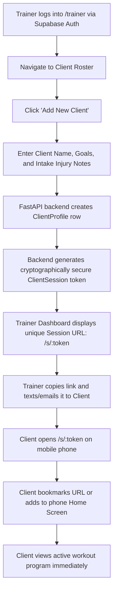
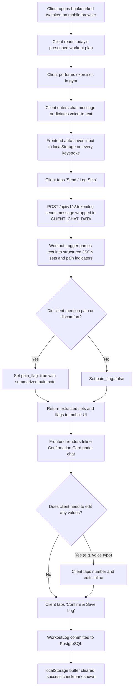
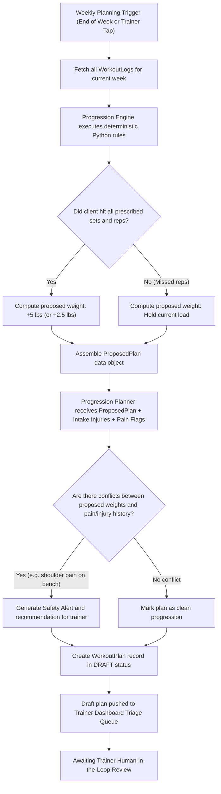
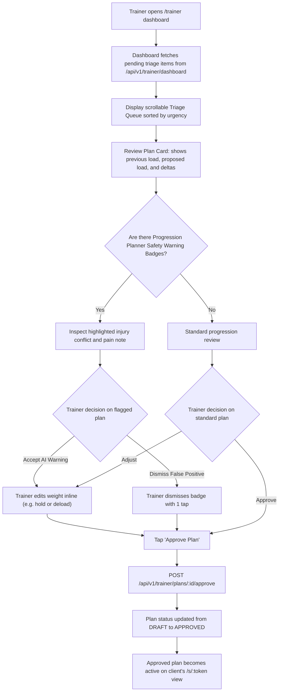
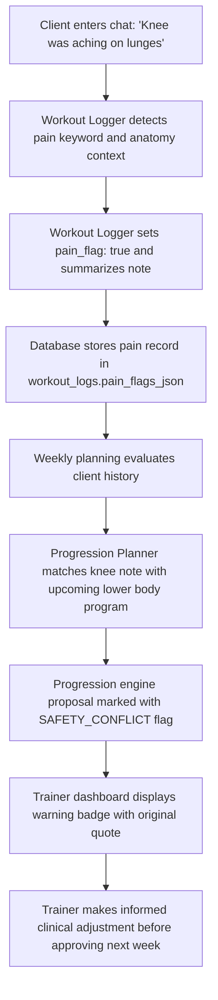
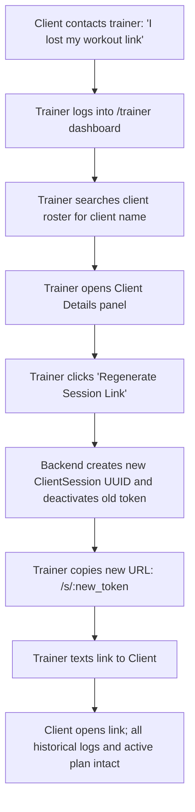

# 03. User Flows & System Journey Diagrams

This document illustrates the end-to-end user journeys, system state transitions, and multi-agent orchestration flows within the **Trainer Progression App**.

---

## 1. Client Onboarding Flow

How a trainer creates a client record and delivers an instant-access session link without requiring the client to create an account.



---

## 2. Weekly Workout Logging Cycle

The in-gym mobile experience where a client logs training via chat or voice dictation, reviews extracted sets, and commits the log to the database.



---

## 3. Weekly Progression & Planning Cycle

How the system combines deterministic weight math with AI safety reasoning to generate a staged weekly plan for trainer review.



---

## 4. Trainer Dashboard Review & Approval Flow

The trainer's rapid triage and 1-click approval workflow.



---

## 5. End-to-End Agent Orchestration Pipeline

Sequence diagram showing data flow, component boundaries, and Human-in-the-Loop gates across all three agents.

```mermaid
sequenceDiagram
    autonumber
    actor Client
    participant Frontend as Mobile Browser (/s/:token)
    participant API as FastAPI Backend
    participant DB as Supabase PostgreSQL
    participant A1 as Workout Logger
    participant PE as Deterministic Engine
    participant A2 as Progression Planner
    actor Trainer
    participant A3 as Trainer Assistant

    %% Session Logging
    Client->>Frontend: Speaks/types "Squat 225 3x5, Bench 135 3x10 felt shoulder pinch"
    Frontend->>API: POST /s/:token/log (raw text)
    API->>A1: Parse with untrusted XML tags
    A1-->>API: Extracted sets + pain_flag: true (shoulder)
    API-->>Frontend: Render confirmation card
    Client->>Frontend: Taps "Confirm Log"
    Frontend->>API: Commit verified log
    API->>DB: INSERT into workout_logs

    %% Progression Generation
    Note over API,PE: End of training week triggered
    API->>DB: Query week's workout logs
    DB-->>API: Completed sets & reps
    API->>PE: compute_next_week(logged_sets, current_plan)
    PE-->>API: Proposed weights (+5 lbs squat, +5 lbs bench)
    API->>A2: Evaluate ProposedPlan + Injuries + Pain Flags
    A2-->>API: Safety Warning: Block bench +5 lbs due to shoulder pinch
    API->>DB: INSERT into workout_plans (status: DRAFT)

    %% Human in the Loop Review
    Trainer->>API: GET /trainer/dashboard
    API-->>Trainer: Staged plan with safety alert badge
    Trainer->>API: Override bench to hold 135 lbs; Tap "Approve"
    API->>DB: UPDATE workout_plans SET status='APPROVED'

    %% Adherence & Outreach
    API->>A3: Daily background adherence scan
    A3->>DB: Query client check-in timestamps
    A3-->>API: Flag Client B as 4 days inactive; draft check-in message
    Trainer->>API: Review triage queue; approves outreach message
```

---

## 6. In-Workout Pain Flag Escalation Flow

How a casual mention of discomfort is systematically tracked, prevented from causing immediate progression overloads, and surfaced to the coach.



---

## 7. Session Link Recovery & Regeneration Flow

How a trainer assists a client who has lost their phone, deleted bookmarks, or requires a session link reset.


