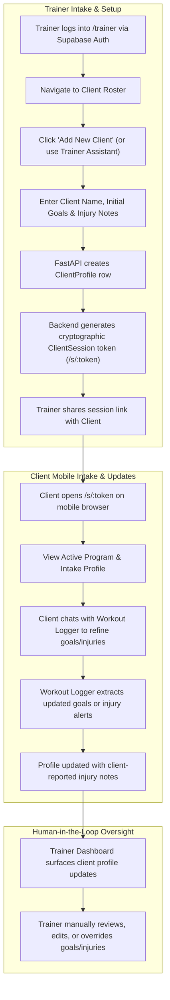
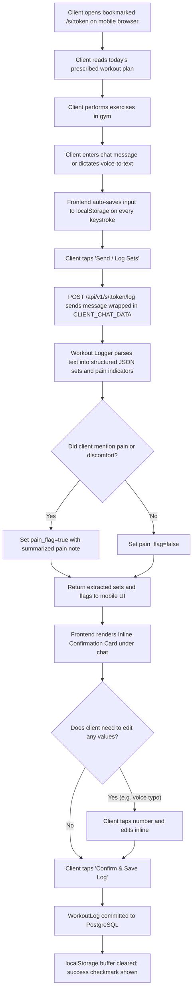
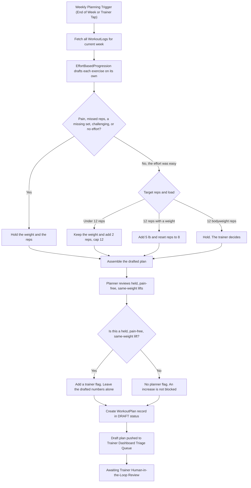
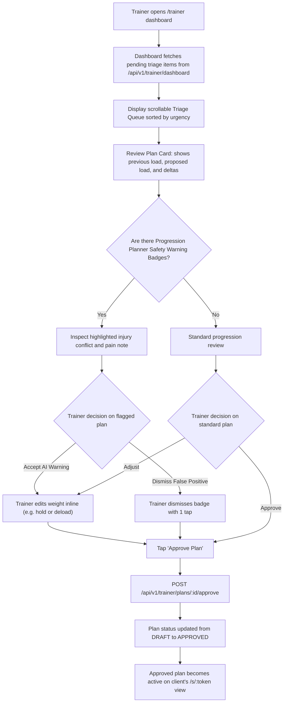
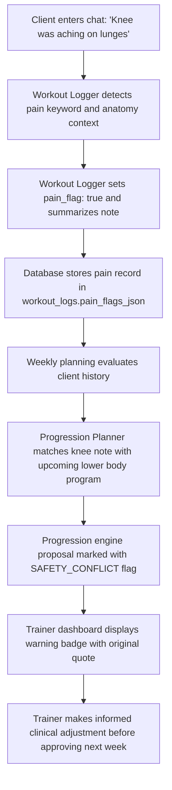
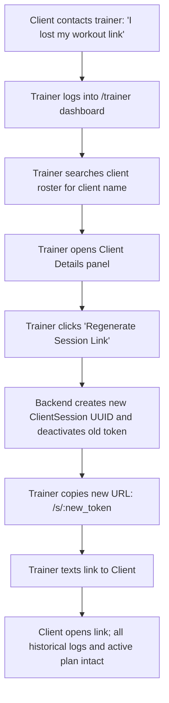

# 03. User Flows & System Journey Diagrams

This document illustrates the end-to-end user journeys, system state transitions, and multi-agent orchestration flows within the **Trainer Progression App**.

---

## 1. Dual Client Onboarding & Intake Flow (Option B)

How client profiles and intake information are populated with autonomy for both trainer and client, backed by trainer human-in-the-loop oversight.



---

## 2. Weekly Workout Logging Cycle

The in-gym mobile experience where a client logs training via chat or voice dictation, reviews extracted sets, and commits the log to the database.



---

## 3. Weekly Progression & Planning Cycle

How `EffortBasedProgression` drafts next week's weights and reps, and how the planner flags a held lift for the trainer to review. The planner does not change the numbers.



---

## 4. Trainer Dashboard Review & Approval Flow

The trainer's rapid triage and 1-click approval workflow.



---

## 5. End-to-End Agent Orchestration Pipeline

Sequence diagram showing data flow, component boundaries, and Human-in-the-Loop gates across all three agents.

```mermaid
sequenceDiagram
    autonumber
    actor Client
    participant Frontend as Mobile Browser (/s/:token)
    participant API as FastAPI Backend
    participant DB as Supabase PostgreSQL
    participant A1 as Workout Logger
    participant PE as Deterministic Engine
    participant A2 as Progression Planner
    actor Trainer
    participant A3 as Trainer Assistant

    %% Session Logging
    Client->>Frontend: Speaks/types "Squat was easy, hit every set. Bench felt challenging, no pain"
    Frontend->>API: POST /s/:token/log (raw text)
    API->>A1: Parse with untrusted XML tags
    A1-->>API: Extracted sets. Squat effort easy. Bench effort challenging. No pain
    API-->>Frontend: Render confirmation card
    Client->>Frontend: Taps "Confirm Log"
    Frontend->>API: Commit verified log
    API->>DB: INSERT into workout_logs

    %% Progression Generation
    Note over API,PE: End of training week triggered
    API->>DB: Query week's workout logs
    DB-->>API: Completed sets, reps, and effort
    API->>PE: compute_next_week(logged_sets, current_plan)
    PE-->>API: Reps-first draft. Easy squat under 12 gains 2 reps. Challenging bench holds weight and reps
    API->>A2: Review held, pain-free, same-weight lifts
    A2-->>API: Flag the held bench for the trainer. Drafted numbers stay unchanged
    API->>DB: INSERT into workout_plans (status: DRAFT)

    %% Human in the Loop Review
    Trainer->>API: GET /trainer/dashboard
    API-->>Trainer: Staged plan with a held-lift flag
    Trainer->>API: Reviews the held bench flag; Tap "Approve"
    API->>DB: UPDATE workout_plans SET status='APPROVED'

    %% Adherence & Outreach
    API->>A3: Daily background adherence scan
    A3->>DB: Query client check-in timestamps
    A3-->>API: Flag Client B as 4 days inactive; draft check-in message
    Trainer->>API: Review triage queue; approves outreach message
```

---

## 6. In-Workout Pain Flag Escalation Flow

How a casual mention of discomfort is systematically tracked, prevented from causing immediate progression overloads, and surfaced to the coach.



---

## 7. Session Link Recovery & Regeneration Flow

How a trainer assists a client who has lost their phone, deleted bookmarks, or requires a session link reset.


