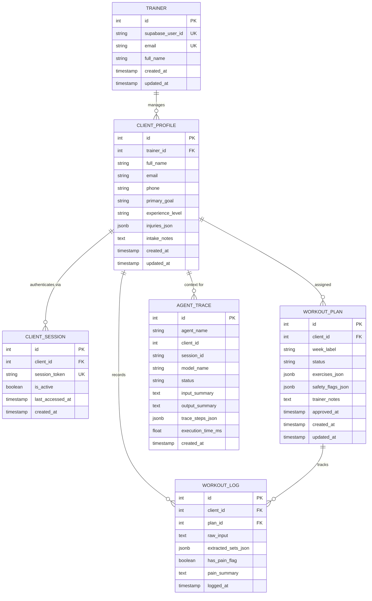

# 04. Database Schema & Data Model Reference

This document provides a comprehensive reference for the PostgreSQL database architecture powering the **Trainer Progression App**, managed via **SQLAlchemy 2.0 (asyncio)** and **Alembic**.

---

## 1. Entity-Relationship (ER) Diagram



---

## 2. Table Specifications

### 2.1. `trainers`
Represents independent personal trainers authenticated through Supabase Auth.

| Column | Type | Constraints | Default | Description |
| :--- | :--- | :--- | :--- | :--- |
| `id` | `INTEGER` | `PRIMARY KEY`, indexed | Auto-increment | Unique internal ID for relational foreign keys. |
| `supabase_user_id`| `VARCHAR(255)`| `UNIQUE`, `NOT NULL`, indexed | None | UUID string assigned by Supabase Auth (`auth.users.id`). |
| `email` | `VARCHAR(255)`| `UNIQUE`, `NOT NULL`, indexed | None | Trainer login and communication email. |
| `full_name` | `VARCHAR(255)`| `NULLABLE` | None | Trainer display name. |
| `created_at` | `TIMESTAMP` | `NOT NULL` | `utcnow` | Account creation timestamp. |
| `updated_at` | `TIMESTAMP` | `NOT NULL` | `utcnow` | Auto-updating timestamp on record modification. |

---

### 2.2. `client_profiles`
Stores client personal information, fitness objectives, intake summaries, and joint health/injury considerations.

| Column | Type | Constraints | Default | Description |
| :--- | :--- | :--- | :--- | :--- |
| `id` | `INTEGER` | `PRIMARY KEY`, indexed | Auto-increment | Unique internal client identifier. |
| `trainer_id` | `INTEGER` | `FOREIGN KEY (trainers.id)`, `NOT NULL`, indexed | None | Owning trainer. Cascade deletes if trainer is deleted. |
| `full_name` | `VARCHAR(255)`| `NOT NULL` | None | Client full name. |
| `email` | `VARCHAR(255)`| `NULLABLE` | None | Client contact email. |
| `phone` | `VARCHAR(50)` | `NULLABLE` | None | Client SMS/contact number. |
| `primary_goal` | `VARCHAR(255)`| `NULLABLE` | None | High-level goal (e.g., *"Hypertrophy"*, *"Strength"*, *"Rehab"*). |
| `experience_level`| `VARCHAR(100)`| `NULLABLE` | None | Client training background (e.g., *"Beginner"*, *"Intermediate"*). |
| `injuries_json`| `JSONB` | `NOT NULL` | `[]` | List of anatomical restrictions (e.g., `["Torn meniscus (2024)"]`). Read by the Progression Planner. |
| `intake_notes` | `TEXT` | `NULLABLE` | None | Conversational summary parsed during initial client onboarding. |
| `created_at` | `TIMESTAMP` | `NOT NULL` | `utcnow` | Profile creation timestamp. |
| `updated_at` | `TIMESTAMP` | `NOT NULL` | `utcnow` | Timestamp of last profile update. |

---

### 2.3. `client_sessions`
Manages cryptographic session tokens powering the zero-account client mobile experience (`/s/:token`).

| Column | Type | Constraints | Default | Description |
| :--- | :--- | :--- | :--- | :--- |
| `id` | `INTEGER` | `PRIMARY KEY`, indexed | Auto-increment | Internal session record ID. |
| `client_id` | `INTEGER` | `FOREIGN KEY (client_profiles.id)`, `NOT NULL`, indexed | None | Associated client profile. Cascade on delete. |
| `session_token` | `VARCHAR(64)` | `UNIQUE`, `NOT NULL`, indexed | `uuid4()` | 128-bit cryptographic random UUID used in client URLs. |
| `is_active` | `BOOLEAN` | `NOT NULL` | `TRUE` | Soft deactivation flag allowing trainers to revoke access. |
| `last_accessed_at`| `TIMESTAMP` | `NULLABLE` | None | Timestamp of last client activity via this session link. |
| `created_at` | `TIMESTAMP` | `NOT NULL` | `utcnow` | Token generation timestamp. |

---

### 2.4. `workout_plans`
Stores weekly training programs prescribed by the coach, generated by the progression engine, and reviewed by the Progression Planner.

| Column | Type | Constraints | Default | Description |
| :--- | :--- | :--- | :--- | :--- |
| `id` | `INTEGER` | `PRIMARY KEY`, indexed | Auto-increment | Unique plan identifier. |
| `client_id` | `INTEGER` | `FOREIGN KEY (client_profiles.id)`, `NOT NULL`, indexed | None | Target client. Cascade on delete. |
| `week_label` | `VARCHAR(50)` | `NOT NULL` | None | ISO week or label (e.g., `"2026-W45"`). |
| `status` | `VARCHAR(50)` | `NOT NULL`, indexed | `'draft'` | Plan lifecycle state: `'draft'`, `'approved'`, or `'archived'`. |
| `exercises_json`| `JSONB` | `NOT NULL` | `[]` | Prescribed exercise array (exercise ID, target sets, reps, weights). |
| `safety_flags_json`| `JSONB` | `NOT NULL` | `[]` | Safety alerts emitted by the Progression Planner (e.g., warning of shoulder conflict). |
| `trainer_notes`| `TEXT` | `NULLABLE` | None | Custom coaching instructions or client feedback. |
| `approved_at` | `TIMESTAMP` | `NULLABLE` | None | Timestamp when trainer signed off on the plan. |
| `created_at` | `TIMESTAMP` | `NOT NULL` | `utcnow` | Plan generation timestamp. |
| `updated_at` | `TIMESTAMP` | `NOT NULL` | `utcnow` | Timestamp of last adjustment. |

#### JSON Schema for `exercises_json`:
```json
[
  {
    "exercise_id": "ex_bench",
    "name": "Barbell Bench Press",
    "sets": 3,
    "target_reps": 10,
    "target_weight_lbs": 135.0,
    "rpe_target": 8.0,
    "notes": "Pause at chest on every rep"
  }
]
```

---

### 2.5. `workout_logs`
Records performance data submitted by clients, including raw voice/chat inputs and Workout Logger structured extractions.

| Column | Type | Constraints | Default | Description |
| :--- | :--- | :--- | :--- | :--- |
| `id` | `INTEGER` | `PRIMARY KEY`, indexed | Auto-increment | Unique workout log ID. |
| `client_id` | `INTEGER` | `FOREIGN KEY (client_profiles.id)`, `NOT NULL`, indexed | None | Logging client. Cascade on delete. |
| `plan_id` | `INTEGER` | `FOREIGN KEY (workout_plans.id)`, `NULLABLE`, indexed | None | Reference to prescribed plan. `SET NULL` on plan delete. |
| `client_request_id` | `VARCHAR(64)` | `UNIQUE`, `NULLABLE`, indexed | None | Client-generated UUID for idempotency protection. |
| `raw_input` | `TEXT` | `NOT NULL` | None | Original unstructured chat message or voice transcript. |
| `extracted_sets_json`| `JSONB` | `NOT NULL` | `[]` | Structured sets parsed by the Workout Logger and confirmed by client. |
| `has_pain_flag` | `BOOLEAN` | `NOT NULL` | `FALSE` | High-level boolean indicator for fast query filtering. |
| `pain_summary` | `TEXT` | `NULLABLE` | None | Workout Logger summary of reported discomfort or fatigue. |
| `logged_at` | `TIMESTAMP` | `NOT NULL` | `utcnow` | Timestamp of log submission. |

#### JSON Schema for `extracted_sets_json`:
```json
[
  {
    "exercise_id": "ex_bench",
    "set_num": 1,
    "reps": 10,
    "weight_lbs": 135.0,
    "pain_flag": false,
    "note": null
  },
  {
    "exercise_id": "bench_press",
    "set_num": 2,
    "reps": 8,
    "weight_lbs": 135.0,
    "pain_flag": true,
    "note": "shoulder pinching at bottom of rep"
  }
]
```

---

### 2.6. `agent_traces`
Dedicated observability log storing step-by-step audit records for every AI agent execution.

| Column | Type | Constraints | Default | Description |
| :--- | :--- | :--- | :--- | :--- |
| `id` | `INTEGER` | `PRIMARY KEY`, indexed | Auto-increment | Unique trace event ID. |
| `agent_name` | `VARCHAR(100)`| `NOT NULL`, indexed | None | Name of executing agent (`Agent1_Intake`, `Agent2_Safety`, `Agent3_Admin`). |
| `client_id` | `INTEGER` | `NULLABLE`, indexed | None | Client associated with execution (if scoped to client). |
| `session_id` | `VARCHAR(100)`| `NULLABLE` | None | Correlation ID for multi-step workflows. |
| `model_name` | `VARCHAR(100)`| `NOT NULL` | None | Active Anthropic model ID (e.g., `claude-sonnet-5-5`). |
| `status` | `VARCHAR(50)` | `NOT NULL` | `'success'` | Outcome: `'success'`, `'error'`, or `'timeout'`. |
| `input_summary`| `TEXT` | `NULLABLE` | None | Sanitized summary of prompt context. |
| `output_summary`| `TEXT` | `NULLABLE` | None | Summary of generated completion or tool call. |
| `trace_steps_json`| `JSONB` | `NOT NULL` | `[]` | Chronological steps: model thought, tool arguments, return data. |
| `execution_time_ms`| `FLOAT` | `NOT NULL` | `0.0` | Total execution duration in milliseconds. |
| `created_at` | `TIMESTAMP` | `NOT NULL`, indexed | `utcnow` | Trace creation timestamp. |

---

## 3. Database Indexes & Query Optimization

| Index Name | Table | Columns | Purpose |
| :--- | :--- | :--- | :--- |
| `ix_client_sessions_token` | `client_sessions` | `session_token` (UNIQUE) | $O(1)$ client lookup on every `/s/:token` page load and API call. |
| `ix_workout_plans_client_week` | `workout_plans` | `client_id, week_label` | Fast retrieval of client's active program by week. |
| `ix_workout_plans_status` | `workout_plans` | `status` | High-speed triage queries fetching pending `'draft'` plans. |
| `ix_workout_logs_client_date` | `workout_logs` | `client_id, logged_at DESC` | Instant retrieval of client history for progression calculation. |
| `ix_workout_logs_pain` | `workout_logs` | `has_pain_flag` | Filter for injury analysis and compliance alerts. |
| `ix_agent_traces_created_at` | `agent_traces` | `created_at DESC` | Time-series query optimization for developer debugging. |

---

## 4. Alembic Migration Procedures

### Running Migrations in Development
```bash
cd backend
alembic upgrade head
```

### Creating New Schema Migrations
When modifying models in `backend/app/models/`:
```bash
cd backend
alembic revision --autogenerate -m "describe_schema_change"
alembic upgrade head
```

### Rollback Strategy
```bash
# Roll back by one revision
alembic downgrade -1

# Roll back to clean base
alembic downgrade base
```
